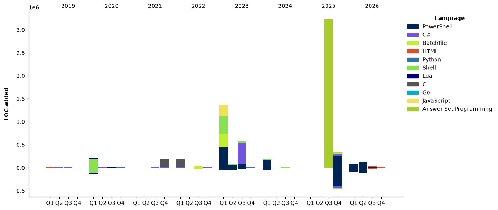

- 👋 Hi, I’m @Stelzi79
- 👀 I’m interested in ...
- 🌱 I’m currently learning ...
- 💞️ I’m looking to collaborate on ...
- 📫 How to reach me ...

<!--START_SECTION:waka-->


**🐱 My GitHub Data** 

> 📦 187.0 kB Used in GitHub's Storage 
 > 
> 🏆 749 Contributions in the Year 2026
 > 
> 🚫 Not Opted to Hire
 > 
> 📜 70 Public Repositories 
 > 
> 🔑 37 Private Repositories 
 > 
**I'm a Night 🦉** 

```text
🌞 Morning                980 commits         █████░░░░░░░░░░░░░░░░░░░░   21.82 % 
🌆 Daytime                517 commits         ███░░░░░░░░░░░░░░░░░░░░░░   11.51 % 
🌃 Evening                1982 commits        ███████████░░░░░░░░░░░░░░   44.12 % 
🌙 Night                  1013 commits        ██████░░░░░░░░░░░░░░░░░░░   22.55 % 
```
📅 **I'm Most Productive on Thursday** 

```text
Monday                   274 commits         ██░░░░░░░░░░░░░░░░░░░░░░░   06.10 % 
Tuesday                  976 commits         █████░░░░░░░░░░░░░░░░░░░░   21.73 % 
Wednesday                639 commits         ████░░░░░░░░░░░░░░░░░░░░░   14.23 % 
Thursday                 1488 commits        ████████░░░░░░░░░░░░░░░░░   33.13 % 
Friday                   592 commits         ███░░░░░░░░░░░░░░░░░░░░░░   13.18 % 
Saturday                 374 commits         ██░░░░░░░░░░░░░░░░░░░░░░░   08.33 % 
Sunday                   149 commits         █░░░░░░░░░░░░░░░░░░░░░░░░   03.32 % 
```


📊 **This Week I Spent My Time On** 

```text
🕑︎ Time Zone: Europe/Vienna

💬 Programming Languages: 
Bash                     1 hr                █████████░░░░░░░░░░░░░░░░   37.29 % 
TOML                     36 mins             ██████░░░░░░░░░░░░░░░░░░░   22.43 % 
SSH Config               27 mins             ████░░░░░░░░░░░░░░░░░░░░░   16.89 % 
Go                       22 mins             ███░░░░░░░░░░░░░░░░░░░░░░   13.81 % 
YAML                     9 mins              █░░░░░░░░░░░░░░░░░░░░░░░░   05.76 % 

🔥 Editors: 
VS Code                  2 hrs 23 mins       ██████████████████████░░░   89.29 % 
OpenCode                 17 mins             ███░░░░░░░░░░░░░░░░░░░░░░   10.71 % 

🐱‍💻 Projects: 
herdr                    36 mins             ██████░░░░░░░░░░░░░░░░░░░   22.64 % 
common                   32 mins             █████░░░░░░░░░░░░░░░░░░░░   19.95 % 
stelzi79                 27 mins             ████░░░░░░░░░░░░░░░░░░░░░   16.89 % 
kb-manager               22 mins             ███░░░░░░░░░░░░░░░░░░░░░░   13.76 % 
arr-stack                19 mins             ███░░░░░░░░░░░░░░░░░░░░░░   11.93 % 

💻 Operating System: 
Windows                  1 hr 9 mins         ███████████░░░░░░░░░░░░░░   43.15 % 
WSL                      1 hr 5 mins         ██████████░░░░░░░░░░░░░░░   40.89 % 
Linux                    25 mins             ████░░░░░░░░░░░░░░░░░░░░░   15.97 % 
```

🤖 **AI Coding This Week** 

```text
⏱ AI Coding Time: 21 mins (13.08%)

✍️ 0 lines written by AI, 67 lines written by hand (0.0% AI-written)

🔤 37,167 Input Tokens, 8,402 Output Tokens

💵 $0.97 Estimated AI Cost This Week

🧠 3 AI Sessions, 5 AI Prompts

Flint                    0 lines             ░░░░░░░░░░░░░░░░░░░░░░░░░   00.00 % 

🔎 AI Coding Insights:
🧑‍💻 Mostly Hands-On — 0.0% of written lines came from AI
📝 Concise Prompter — average 20 characters per prompt
🔁 Iterative Prompter — average 2 prompts per session
🔍 Hands-On Reviewer — 100.0% of changed lines were hand-edited
```

**I Mostly Code in Shell** 

```text
Shell                    15 repos            █████████░░░░░░░░░░░░░░░░   34.09 % 
C#                       7 repos             ████░░░░░░░░░░░░░░░░░░░░░   15.91 % 
Go                       6 repos             ███░░░░░░░░░░░░░░░░░░░░░░   13.64 % 
Answer Set Programming   1 repo              █░░░░░░░░░░░░░░░░░░░░░░░░   02.27 % 
JavaScript               1 repo              █░░░░░░░░░░░░░░░░░░░░░░░░   02.27 % 
```


**Timeline**




 Last Updated on 04/11/2026 07:14:48 UTC
<!--END_SECTION:waka-->

<!---
Stelzi79/Stelzi79 is a ✨ special ✨ repository because its `README.md` (this file) appears on your GitHub profile.
You can click the Preview link to take a look at your changes.
--->
