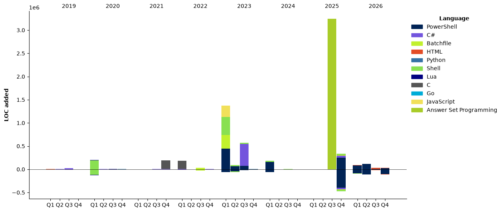

- 👋 Hi, I’m @Stelzi79
- 👀 I’m interested in ...
- 🌱 I’m currently learning ...
- 💞️ I’m looking to collaborate on ...
- 📫 How to reach me ...

<!--START_SECTION:waka-->


**🐱 My GitHub Data** 

> 📦 188.1 kB Used in GitHub's Storage 
 > 
> 🏆 803 Contributions in the Year 2026
 > 
> 🚫 Not Opted to Hire
 > 
> 📜 70 Public Repositories 
 > 
> 🔑 37 Private Repositories 
 > 
**I'm a Night 🦉** 

```text
🌞 Morning                991 commits         █████░░░░░░░░░░░░░░░░░░░░   21.79 % 
🌆 Daytime                525 commits         ███░░░░░░░░░░░░░░░░░░░░░░   11.55 % 
🌃 Evening                2002 commits        ███████████░░░░░░░░░░░░░░   44.03 % 
🌙 Night                  1029 commits        ██████░░░░░░░░░░░░░░░░░░░   22.63 % 
```
📅 **I'm Most Productive on Thursday** 

```text
Monday                   280 commits         ██░░░░░░░░░░░░░░░░░░░░░░░   06.16 % 
Tuesday                  993 commits         █████░░░░░░░░░░░░░░░░░░░░   21.84 % 
Wednesday                643 commits         ████░░░░░░░░░░░░░░░░░░░░░   14.14 % 
Thursday                 1497 commits        ████████░░░░░░░░░░░░░░░░░   32.92 % 
Friday                   605 commits         ███░░░░░░░░░░░░░░░░░░░░░░   13.31 % 
Saturday                 377 commits         ██░░░░░░░░░░░░░░░░░░░░░░░   08.29 % 
Sunday                   152 commits         █░░░░░░░░░░░░░░░░░░░░░░░░   03.34 % 
```


📊 **This Week I Spent My Time On** 

```text
🕑︎ Time Zone: Europe/Vienna

💬 Programming Languages: 
Markdown                 8 hrs 24 mins       ██████░░░░░░░░░░░░░░░░░░░   24.38 % 
YAML                     7 hrs 43 mins       ██████░░░░░░░░░░░░░░░░░░░   22.41 % 
Go                       6 hrs 53 mins       █████░░░░░░░░░░░░░░░░░░░░   20.02 % 
Other                    2 hrs 41 mins       ██░░░░░░░░░░░░░░░░░░░░░░░   07.83 % 
Bash                     2 hrs               █░░░░░░░░░░░░░░░░░░░░░░░░   05.83 % 

🔥 Editors: 
VS Code                  34 hrs 25 mins      █████████████████████████   99.92 % 
OpenCode                 1 min               ░░░░░░░░░░░░░░░░░░░░░░░░░   00.08 % 

🐱‍💻 Projects: 
dps                      10 hrs 35 mins      ████████░░░░░░░░░░░░░░░░░   30.77 % 
badges                   8 hrs 7 mins        ██████░░░░░░░░░░░░░░░░░░░   23.59 % 
stack                    4 hrs 16 mins       ███░░░░░░░░░░░░░░░░░░░░░░   12.39 % 
02-ai                    3 hrs 14 mins       ██░░░░░░░░░░░░░░░░░░░░░░░   09.41 % 
stelzi79                 2 hrs 17 mins       ██░░░░░░░░░░░░░░░░░░░░░░░   06.67 % 

💻 Operating System: 
WSL                      33 hrs 55 mins      █████████████████████████   98.46 % 
Windows                  19 mins             ░░░░░░░░░░░░░░░░░░░░░░░░░   00.94 % 
Linux                    12 mins             ░░░░░░░░░░░░░░░░░░░░░░░░░   00.60 % 
```

🤖 **AI Coding This Week** 

```text
⏱ AI Coding Time: 27 hrs 23 mins (79.5%)

✍️ 2,672 lines written by AI, 479 lines written by hand (84.8% AI-written)

🔤 19,713,482 Input Tokens, 315,823 Output Tokens

💵 $10.80 Estimated AI Cost This Week

🧠 21 AI Sessions, 85 AI Prompts

Qwen                     2,681 lines         █████████████████████████   100.00 % 

🔎 AI Coding Insights:
🤖 AI-Driven — 84.8% of written lines came from AI
📝 Concise Prompter — average 79 characters per prompt
🔁 Iterative Prompter — average 4 prompts per session
🚀 High AI Trust — 17.66% of changed lines were hand-edited
```

**I Mostly Code in Shell** 

```text
Shell                    15 repos            █████████░░░░░░░░░░░░░░░░   34.09 % 
C#                       7 repos             ████░░░░░░░░░░░░░░░░░░░░░   15.91 % 
Go                       6 repos             ███░░░░░░░░░░░░░░░░░░░░░░   13.64 % 
Answer Set Programming   1 repo              █░░░░░░░░░░░░░░░░░░░░░░░░   02.27 % 
JavaScript               1 repo              █░░░░░░░░░░░░░░░░░░░░░░░░   02.27 % 
```


**Timeline**




 Last Updated on 24/11/2026 10:42:10 UTC
<!--END_SECTION:waka-->

<!---
Stelzi79/Stelzi79 is a ✨ special ✨ repository because its `README.md` (this file) appears on your GitHub profile.
You can click the Preview link to take a look at your changes.
--->
